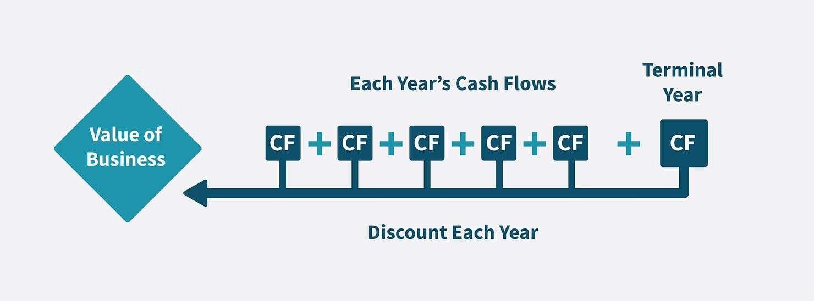
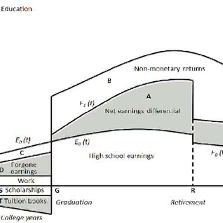
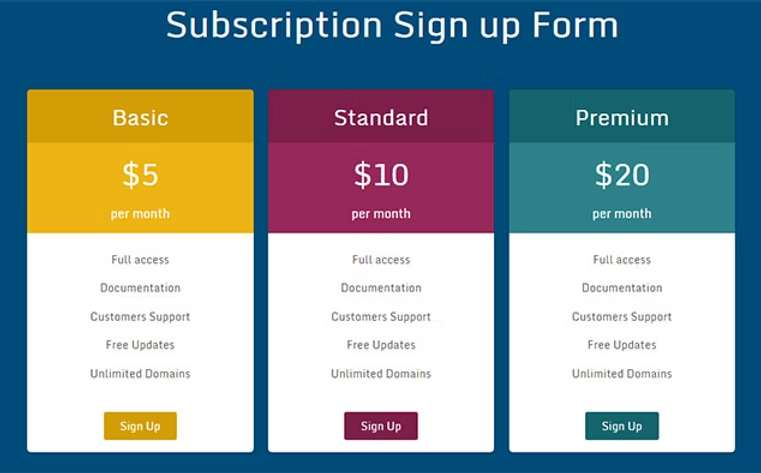
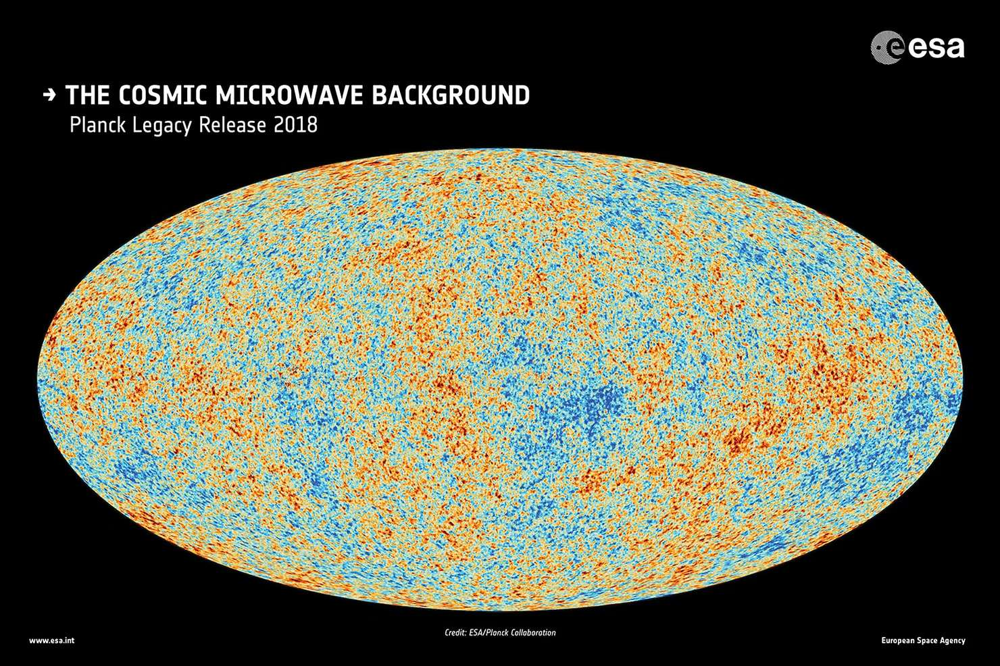

Every finance student should be aware of DCF. Standing for Discounted Cash Flow, it is a widely used valuation technique that intrinsically measures the value of a company based on the future cash flow it generates. While seemed overwhelming, DCF basically involves determining the present value based on future values. It is an ideology that extends far beyond the scope of finance and can provide profound insights into everyday decisions in various fields.

*Source: [valutico.com](https://valutico.com/discounted-cash-flow-analysis-your-complete-guide-with-examples/)*

## Education Investment Decisions

Education and human capital, are always the most significant investments individuals make, and the principles of DCF can be crucial in evaluating its financial viability. A college degree often leads to increased earnings in the future. DCF allows us to estimate the total incremental income to earn over our career and discount it back to its present value with an appropriate rate, such as inflation or opportunity cost. With this method, we can directly compare the costs of tuition, living expenses, and the opportunity cost that is forgone during college. If the present value of future earnings outweighs these upfront costs, the investment in attending higher education is likely financially favorable.

*Source: [researchgate.net](https://www.researchgate.net/figure/nvestment-in-higher-education-and-private-returns-over-the-life-cycle-Source-McMahon_fig1_259912440)*

## Subscription Services and Payment Plans

Subscriptions are involved in our daily lives, such as YouTube, monthly phone data, and magazines. When you decide between payment options, such as a monthly subscription or a one-time upfront payment, DCF principles help you identify the most cost-effective choice. Monthly subscriptions spread payments over time but often result in higher total costs compared to a one-time upfront payment. By calculating the present value of all future payments using a discount rate, you can determine whether the series of subscriptions is greater or less than the upfront one-time payment. Additionally, opportunity costs and liquidity play a role: choosing monthly payments may use up your cash for alternative investments that yield returns, whereas upfront payments may come with discounts that reduce overall expenditure.

*Source: [phpjabbers.com](https://www.phpjabbers.com/free-pricing-plans-and-subscription-payment-script/)*

## Environmental Policy and Sustainability

DCF principles can be used to assess the trade-offs between current actions and their long-term benefits in environmental protection. Transitioning to renewable energy or implementing stricter emissions controls involves significant installment costs and menu costs, but they also create positive externalities in the future. Policymakers use DCF to calculate the present value of these costs in comparison to the long-term benefits, such as reduced climate impact, lower healthcare costs and avoided pollution. The choice of discount rate is especially critical in these analyses, as it reflects the weight placed on future generations. A lower discount rate values long-term benefits more heavily, supporting policies that prioritize sustainability, whereas a higher rate may emphasize immediate economic growth.

*Source: [geographicbook.com](https://geographicbook.com/environmental-policy/)*

## Time Value of Astronomical Phenomena

In astronomy, the principles of DCF are reflected in how scientists analyze the time-dependent nature of cosmic events. Light from distant galaxies takes millions of years to reach Earth, meaning the information received today represents a snapshot of the past. To estimate the current state of these objects, astronomers use time-evolution models similar to discounting, projecting forward based on known physical laws. This approach is also evident in prioritizing observations of rare and time-sensitive phenomena, such as supernovae or exoplanet transits, where immediate action is necessary to maximize the scientific value of these fleeting opportunities. Furthermore, in studying cosmic inflation and expansion, scientists discount our present universe back to its infant stages using known physical laws and compare it with observational results, the Cosmic Microwave Background. The difference might suggest that our universe went through stages that we have yet to decipher.

*Source: [esa.int](https://www.esa.int/ESA_Multimedia/Images/2018/07/Planck_s_view_of_the_cosmic_microwave_background2)*

The concept of DCF is not confined to spreadsheets and offices; it is a way we approach decisions in our daily lives. Whether it is budgeting, planning for the future, or conducting research, understanding how to value the future in present terms can lead to more informed and balanced choices. Beyond finance, the DCF ideology serves as a universal framework for evaluating trade-offs, making it an indispensable tool across disciplines.
