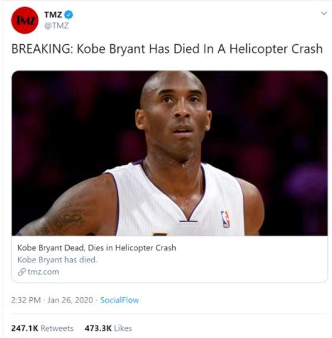

With the advent of the digital age, advertising, marketing, and journalism have been largely transformed by platforms like Instagram, formerly Twitter, and other online news aggregators. These platforms have not only expanded the reach of information but also fueled a culture of instant reporting and targeted advertising. Many publishers now prioritize gossips of celebrities or sensational news to receive more clicks and engagement, while consumer goods companies often use exaggerated claims on advertisement to attract buyers, with little regard for whether their products truly deliver on their promises.

*Source: [cdieurope.eu](https://cdieurope.eu/)*

Although technology has propelled public marketing to new heights, it has also introduced significant ethical. Misleading advertisements often result in misguided consumer choices, and the privacy of individuals is frequently compromised by invasive reporting. While many call for stricter regulations on digital marketing platforms, implementing extensive legal limitations can conflict with the freedom of speech --- an essential cornerstone of civic rights. This raises an important question: where should the line be drawn between freedom of speech and ethical journalism?

## The TMZ Controversy

When basketball legend Kobe Bryant tragically passed away in a helicopter crash in 2020, TMZ was the first outlet to report the news. While their rapid coverage garnered global attention, it also provoked widespread outrage. TMZ released the story before authorities could notify Bryant’s family, leading critics to accuse the outlet of prioritizing speed and public attention over compassion and respect for the grieving family.

*Source: [bmoreprojects.blog](https://bmoreprojects.blog/2020/01/27/dont-blame-the-messenger-a-case-for-defending-tmz/)*

This incident highlights a fundamental ethical dilemma: should the pursuit of public engagement come at the expense of individual dignity? From a marketing perspective, TMZ’s decision likely succeeded in driving public attention and revenue. However, it also damaged the outlet’s reputation among those who viewed the reporting as insensitive and exploitative. The controversy exemplifies the consequences of placing sensationalism above ethics in media and marketing.

## The Role of an Interest-Driven Society

Despite public criticism, morally questionable practices like TMZ's reporting often fail to prompt meaningful change in interest-driven industries. Ironically, public outrage can amplify the attention these outlets seek, further increasing their revenue. In a society where clicks, views, and engagement translate directly into profit, ethical concerns alone are rarely enough to drive systemic reform.

## Government Intervention and Accountability

Change, however, can be achieved through incentives and regulations. Governments have the power to influence corporate behavior by implementing fines or penalties for publishing articles or advertisements that violate ethical standards, such as disclosing private information without the consent of relevant stakeholders. Substantial fines over time would create a financial disincentive for such practices, encouraging media companies to act more responsibly.

*Source: [verywellmind.com](https://www.verywellmind.com/the-incentive-theory-of-motivation-2795382)*

In addition, major media outlets hold significant power to shape public opinion and influence societal discourse. With great power comes great responsibility, and it is incumbent upon these companies to self-regulate by adopting ethical constraints that prioritize accuracy, privacy, and respect for individuals. A commitment to these principles can help ensure that the public has access to news that is both informative and truthful, rather than sensationalized or incomplete.

While freedom of expression is vital for a democratic society, it must be balanced with the need to protect individual privacy and prevent the spread of misinformation. By fostering transparency, promoting accountability, and leveraging government intervention where necessary, it is possible to create a media landscape that upholds both civic rights and ethical standards. Large media corporations and advertisers must recognize their dual responsibility: to drive engagement responsibly and to respect the dignity of the individuals and communities they serve. Only by acknowledging this obligation can they create a more ethical and trustworthy public marketing environment.
