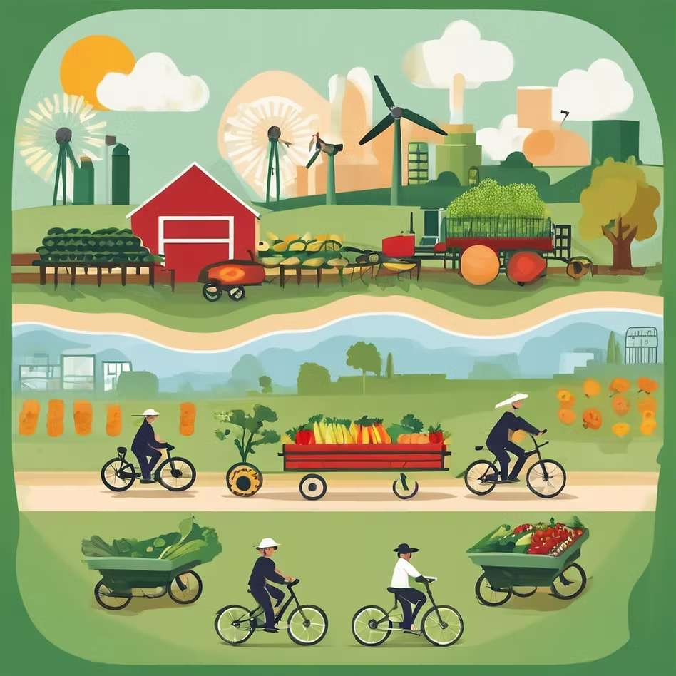
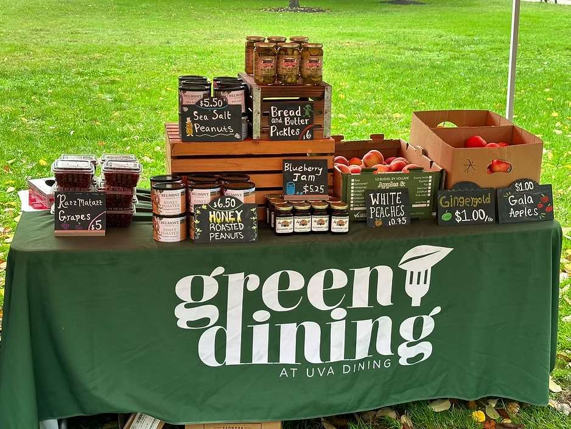
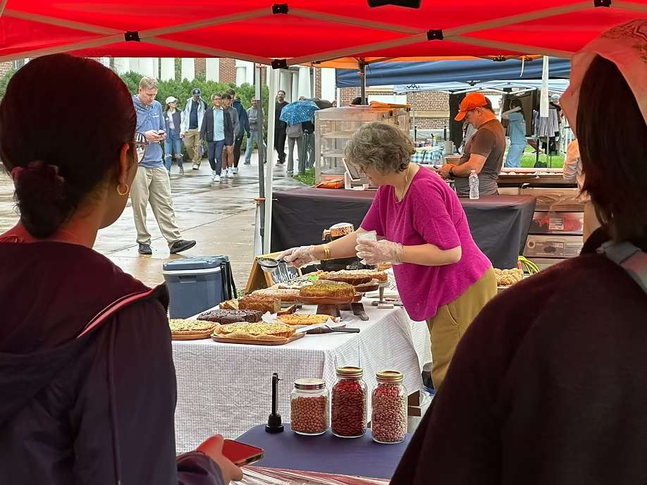
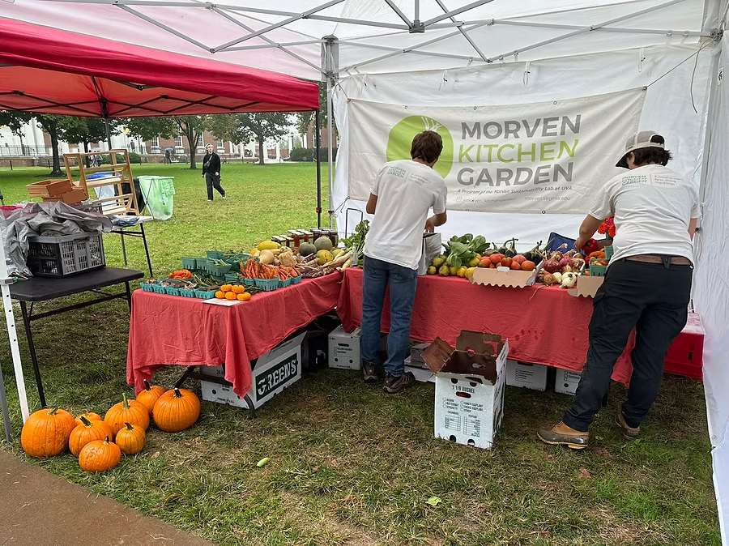

This September, I started my internship at UVA Dine as a sustainability intern, where we dealt with cool food propaganda, local food sourcing, and waste minimization, and most interesting, setting up the C'ville Market.[http://Market.As](http://Market.As)

If you have once been to C'ville Market, you must have been attracted by the chilling atmosphere and fresh food and beverages as well as delicious hand-made snacks there. We organize the event about once a month, where we welcome local retailers and farmers to sell their hand-made products and vegetables grown by themselves at the South Lawn so that students walking from class to class can grab some fresh fruits and snacks and enjoy.

As a second-year student applying to the Commerce School at UVA, I did not initially expect to find myself working in the field of sustainability, much less participating in something as hands-on as the C'ville market. Preparing for and being part of this event has given me a fresh perspective on how the worlds of commerce and sustainability intersect, even in a place as seemingly simple as a market stall selling fruits and vegetables on-grounds.

When most people think of business, they picture bustling offices in skyscrapers, Wall Street traders, or complex financial jargon. So, when I tell them that I am a business student who's been helping with local food markets, it can feel like a bit of a disconnect. But the truth is, what I have come to understand is that sustainability and commerce are not two separate worlds—they’re deeply connected, and both have the power to shape each other in impactful ways.

Growing up, I was always fascinated by science—by the technology that allows us to harness

clean energy from solar panels, or the materials that help reduce pollution. But as I dove deeper into commerce and economics at UVA, I began to see that innovation alone does not drive change. It’s not enough to have an environmentally friendly product or an idea for how to save the planet. There has to be a system that brings those innovations to market, supports them, and makes them accessible to people. That’s where business plays a critical role.

Working with UVA Dine as a sustainability intern has really brought that lesson to life. When we helped organize the C’ville market, we were not just creating a space where local and

marginalized vendors could sell their produce. We were part of a larger effort to support local economies, promote sustainable agriculture, and ensure that food grown right here on campus could reach the community. The market was not just about buying fresh vegetables—it was about creating a network where sustainability could thrive, and commerce played a key role in making that happen.

What struck me most was seeing how commerce helps these small-scale, sustainable efforts

become something real. These farmers and local vendors, who work hard to grow food

sustainably, need more than just idealism to succeed. They need access to consumers, strategies for pricing, marketing, and a platform to sell. By facilitating those connections through the market, we were creating a bridge between environmental ideals and the business mechanisms that make them work in the real world.

The experience also reminded me that commerce is not just about money. It’s about creating value, and that value does not have to be purely financial. At the C’ville market, the value came in the form of healthy, fresh food, environmental stewardship, and supporting marginalized communities. These things matter, and commerce provides the framework to make them a reality. Without the business structure—whether it’s supply chains, pricing models, or the ability to connect with consumers—these sustainable practices might remain just ideas.

Through this experience, I have come to appreciate the role that commerce plays in the bigger picture. It’s not just about profits or growth. It is about building systems that support initiatives like sustainability, helping them grow from ideas into movements that can make a real impact. And as I continue to pursue my studies in business, I feel more confident than ever that commerce can be a powerful force for good when it’s used thoughtfully and intentionally.
