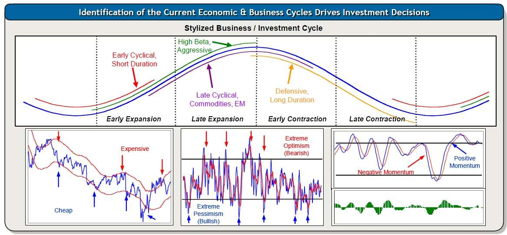
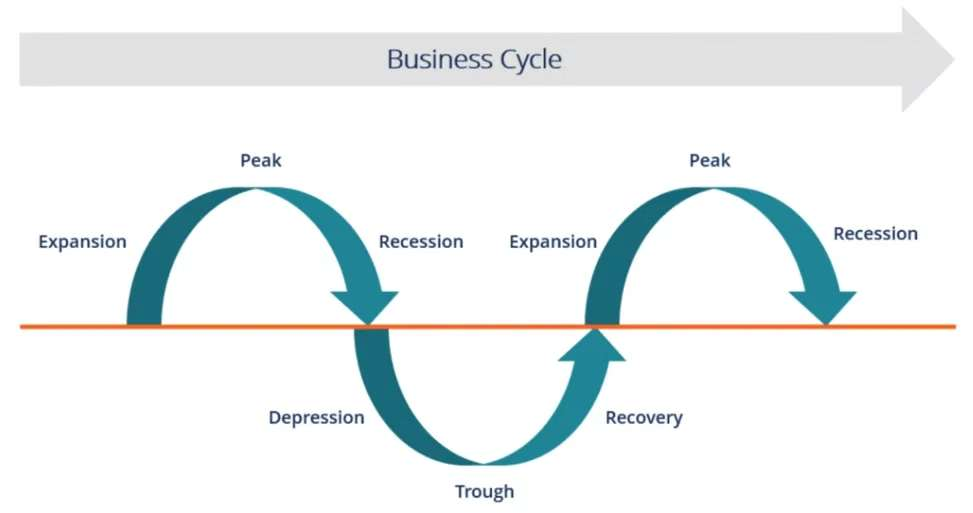
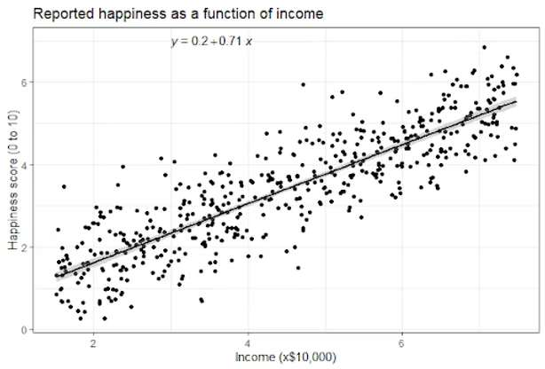

When analyzing business models and the way they generate revenue, cyclicality is always an important topic. The cyclicality of business refers to the natural ebb and flow of economic activities and the volume of the sales of businesses over time. Cyclicality can be driven by macroeconomic factors such as consumer demand, interest rates, government policies, and global events, as well as microeconomic events, like the operational efficiencies of a business, contemporary demand for products, and ever-changing regulatory environments.

*Source: [ritholtz.com](https://ritholtz.com/2010/11/zulauf-cyclicality/)*

In the macroeconomy, cycles are typically divided into four phases: expansion, peak, contraction, and trough. During expansion, economic activity grows as consumer spending increases, businesses flourish, and employment rises. At the peak, economic growth hits its highest point, often accompanied by inflation and market saturation. Contraction follows, marked by declining activity, higher unemployment, and lower consumer confidence. The trough represents the lowest point of the cycle, after which recovery begins, signaling the start of a new expansion phase. Understanding these cycles is crucial for businesses and investors as they navigate risks and opportunities.

*Source: [corporatefinanceinstitute.com](https://corporatefinanceinstitute.com/resources/economics/cyclical-industry/)*

The concept of business cyclicality applies to daily life in several ways, especially when considering the uncertainties that affect economic predictions and decision-making. While uncertainties exist in forecasting business outcomes and any other trends, not 100% of them are entirely unpredictable. Some patterns and behaviors can be anticipated using statistical models and data analysis. For instance, the cyclicality of demand in certain industries, like tourism or luxury goods, can be modeled based on historical data and trends. Tools like time series analysis, regression models, and probability distributions enable businesses to forecast demand, optimize resource allocation, and prepare for downturns. Concepts such as variance, standard deviation, and confidence intervals in statistics are vital in quantifying and managing the uncertainty associated with business cycles.

*Source: [heavy.ai](https://www.heavy.ai/technical-glossary/statistical-modeling)*

According to a famous saying, “Every model is wrong, but some are better.” By leveraging statistical tools, businesses and individuals can distinguish between predictable and unpredictable uncertainties. For example, seasonal patterns in retail sales can often be predicted with high accuracy, allowing companies to plan inventories and staffing accordingly. Similarly, institutional investors use indicators in economics and finance and statistical models to anticipate market trends, arriving at decisions about portfolio diversification and risk management. Recognizing the interplay between predictable patterns and random fluctuations empowers stakeholders to navigate the cyclicality of business more effectively, turning potential risks into strategic advantages. This ability to predict and respond to economic cycles underscores the importance of using statistics in both personal finance and professional decision-making.
