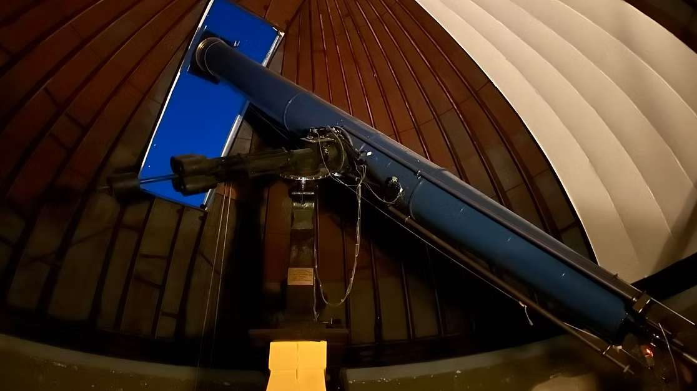

I began my academic journey with a fascination for astronomy. From a young age, I was attracted by the mysteries of the cosmos and the untapped knowledge the universe seemed to hold. Studying astronomy allowed me to explore these in-depth, and I felt a sense of purpose in contributing to scientific understanding. With a great passion for space, I applied for astronomy for UVA undergraduate admission.

But as I delved deeper, something unexpected happened. While astronomy and science in general discover and invent great technologies, I started to notice that the pace at which these discoveries influence the world is often much slower than anticipated. Technologies with the potential to revolutionize industries or improve people's lives are confined to research labs or theoretical discussions for years before they can make a meaningful impact on society.

Why these great scientific breakthroughs took so long to affect the world? As I sought answers, I began to see a new piece of the puzzle—commerce. I realized that business is a crucial bridge between innovation and societal impact. While science can spark new ideas, it’s commerce that brings those ideas into the daily lives of people and empowers real changes by incentivizing people to change their behavior on a large scale.

This realization sparked a new passion for me—finance. The more I learned about it, the more I recognized its profound influence on shaping society. Finance is the engine that powers innovation as it turns ideas into practical, scalable solutions ---- what Venture Capital and other financial institutions do. It creates the financial motivation for people and organizations to adopt new technologies, change habits, and embrace the future. For example, AI as a concept has existed for 10 or 20 years, but it remained a theoretic concept of discussion until 2023 when OpenAI commercialized neural networks and pushed every one of us into such an AI revolution. Since then, everybody has enjoyed the benefits of AI as an excellent workforce, largely increasing productivity.

Now, as a pre-comm student at the University of Virginia, I find myself deeply invested in understanding how capital and markets shape the world. What started as a love for astronomy has evolved into a drive to understand the mechanisms that bring innovations to life. I realized that finance isn’t just about managing money—it is about creating the conditions for progress. Through commerce, we can create incentives that accelerate the adoption of new technologies, solve global problems, and influence society for the better.

Looking forward, I see finance as the key to unlocking the potential of the next generation of innovations. Whether it's in technology, sustainability, or any other industry, my goal is to be at the intersection of commerce and innovation—helping to drive forward ideas that can make a lasting impact on our world.
