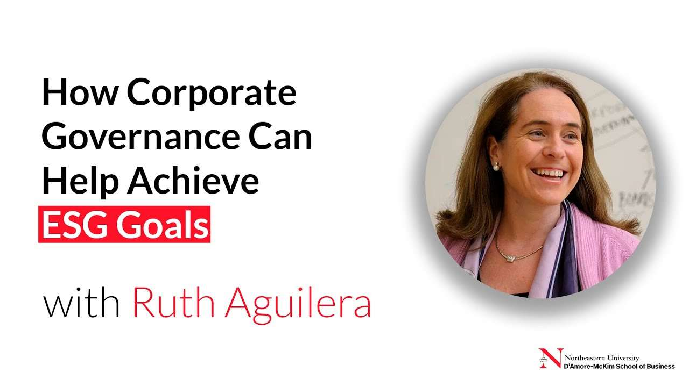
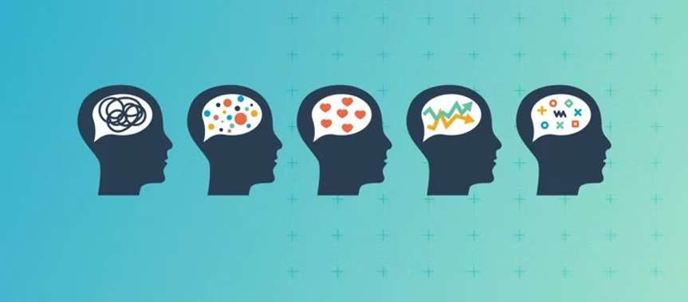

Growing up, I was always taught the importance of protecting our planet. I vividly remember watching TV programs that emphasized preserving ecosystems and reducing carbon emissions. I cried when they gave shots to a dying mammal lying on the beach. I emphasized with their unfortunate fate being an animal that cannot control their living environments. However, At the same time, I saw headlines from my home country about factories being shut down due to their high pollution levels. This dichotomy puzzled me. Why did these entrepreneurs seem indifferent to environmental protection while the government took drastic action? I felt a deep personal responsibility to care for the planet, and it frustrated me that others didn’t share the same urgency.

*Video: [watch on youtube.com](https://www.youtube.com/watch?v=y23WkfWymK8)*

When I first encountered the statement “incentives affect behavior” in a junior high school textbook, I was skeptical. The idea seemed almost insulting. Why should people need external rewards to do the right thing? Shouldn't morality and a sense of duty be enough? I believed strongly that principles should guide our actions, not the lure of rewards. Yet this belief clashed with my observations: people often ignored public appeals to reduce carbon emissions or use public transportation, choosing personal convenience instead. My confusion deepened—if doing the right thing was clear, why didn’t people just do it?

As I studied microeconomics and read more about real-world business decisions, my understanding began to shift. I realized that incentives are not inherently selfish but are fundamental to how human civilization progresses. This idea crystallized during a high school group project on the electric vehicle industry. While researching, I saw how governments offered incentives like tax credits, rebates, and free charging stations to encourage people to adopt EVs. These incentives helped overcome resistance to change by making the switch easier and more appealing. My group even interviewed a local EV owner who said he had considered the environmental impact but was ultimately swayed by the financial savings.

*Via [GIPHY](https://giphy.com/gifs/IaVWq3MSU6EMsVCTkz)*

This experience taught me a valuable lesson: incentives bridge the gap between intention and action. They don’t just encourage personal gain—they enable meaningful changes that benefit society. Suddenly, the actions of entrepreneurs, policymakers, and everyday citizens made more sense. They weren’t acting out of pure indifference; they often lacked the right incentives to align their actions with broader goals.

However, a new question arose: if incentives drive so much of our behavior, does that mean we live in a world of materialism? Was every dream, every act of kindness, ultimately rooted in the desire for rewards? This thought challenged my personal philosophy. I wanted to believe that people acted out of genuine passion or principle, not just for money or recognition.

As I observed more closely, I saw that incentives come in many forms, not just financial ones. When I spent time volunteering at the subway station during junior high school, no one paid me, yet I felt an immense sense of satisfaction helping others find their way. That sense of fulfillment was an incentive in itself. Similarly, I’ve seen my friends spend hours perfecting a drawing, not for any reward but because creating art brings them joy. Even the owner of a small family-run restaurant in my neighborhood cooks not just to make a living, but to share the comforting tastes of home with others.

*Source: [sparkplug.app](https://sparkplug.app/blog/the-psychology-of-incentives-how-to-use-rewards-to-drive-behavior-change)*

I began to realize that incentives are not inherently materialistic. They can be intrinsic, like the joy of solving a difficult problem or the pride of helping someone in need. They can also be social, like earning the respect of peers or the approval of loved ones. These non-material incentives shape countless decisions and actions in my own life, from staying up late to finish a project to practicing piano for hours before a recital.

Now, I see incentives as threads woven into the fabric of human behavior, connecting personal aspirations with collective progress. They are not just tools for personal gain but powerful motivators that can inspire positive change. While principles and duty remain essential, incentives help turn ideals into actions. This understanding has not only resolved my skepticism but has also deepened my belief that thoughtfully designed incentives can help us build a more sustainable, compassionate, and innovative world.
