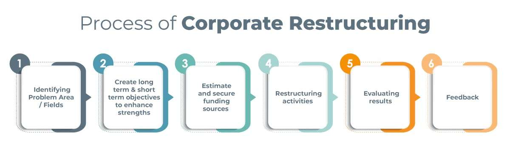
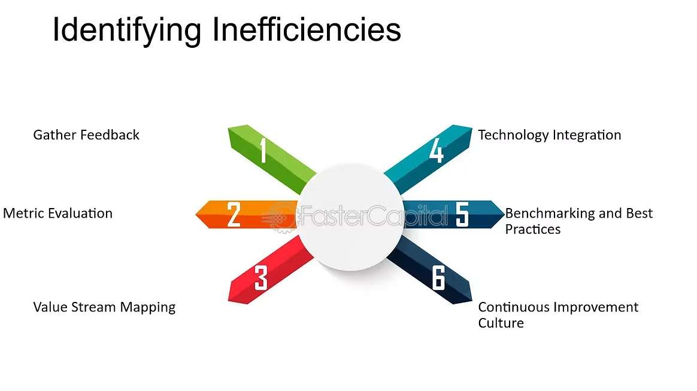

Financial restructuring is a break-and-transform process in businesses that involves reorganizing a company’s financial framework to address challenges or optimize operations in order to achieve a healthier balance sheet and higher profitability. This can include renegotiating debt terms, rebalancing equity structures, or liquidation of certain assets. It is conducted when a company undergoes financial distress, mergers & acquisitions, changes in market conditions, regulatory challenges, and even bankruptcy. By addressing inefficiencies, reducing liabilities, and improving cash flow, financial restructuring helps organizations replenish stability in operations and financial performance and better align with their strategic objectives. Despite being a tool in finance, restructuring offers valuable insights and applications that extend beyond the realm of business into various aspects of daily life.

*Source: [ecapital.com](https://ecapital.com/blog/corporate-restructuring-can-save-your-business-whether-in-decline-or-growth/)*

One key concept of financial restructuring is assessing the status quo and identifying inefficiencies. In personal life, this can translate to evaluating habits or commitments that no longer serve their purpose. For instance, an individual might assess their daily schedule, recognizing that certain activities consume significant time without adding value. Restructuring in this context could mean redistributing time toward more productive or meaningful pursuits, such as learning a new skill or spending quality time reading books. Just as companies sell underperforming assets, individuals can eliminate non-essential commitments to free up resources for personal growth. For example, I used to play with a group of friends, but upon realizing that I seemed not that happy and fulfilled, I quit spending time with them. Instead, I planned the time saved into going to gyms and practicing basketball, which truly helped me a lot in my performance in tournaments.

*Source: [fastercapital.com](https://fastercapital.com/topics/identifying-inefficiencies-in-operations.html)*

Another principle of financial restructuring is optimizing the allocation of resources to attain greater feats. This idea is widely applicable to fields like personal health, where individuals might "restructure" their fitness and nutrition routines. For example, someone not seeing results from their workout plan may consult with their fitness advisors, reassessing and adopting a more effective approach tailored to their goals, such as focusing on muscle-building instead of cardio. Similarly, dietary changes, such as substituting unhealthy snacks with nutrient-rich options, can improve overall well-being. By reallocating resources like time and effort toward strategies with greater benefits, people can optimize their results, just as a company might reassess the internal rate of return of ongoing projects and allocate capital to higher-yield ones.

*Source: [cathe.com](https://cathe.com/new-year-time-reexamine-fitness-goals/)*

Restructuring also involves aligning actions with long-term goals—a concept crucial for personal and professional growth. In corporate finance, a company has to be aware of its long-term goals in order to assess its current performance, whether it be IPO, seeking mergers, or focusing on positive externalities. In career development, this might mean rethinking one’s job role or pursuing additional education to advance in a chosen field. Individuals often face career stagnation due to outdated skills or misaligned objectives. Adopting the principles of restructuring, they can identify gaps, invest their time in certifications or training, and pivot to roles that better match their ambitions.

In essence, financial restructuring is about recognizing inefficiencies, adapting to change, and aligning resources with goals. These concepts are not limited to the corporate world but have profound relevance in everyday life. Whether it is simplifying tasks, improving relationships, or achieving personal objectives, restructuring empowers both individuals and organizations to overcome challenges and thrive in a dynamic environment.
