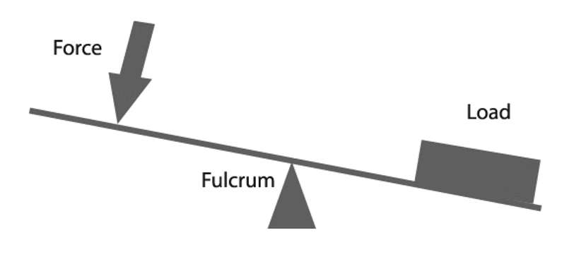
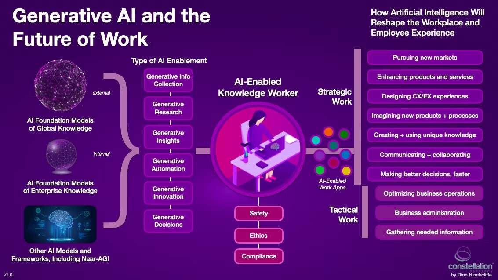
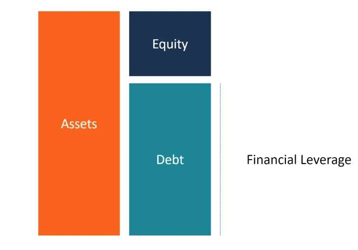
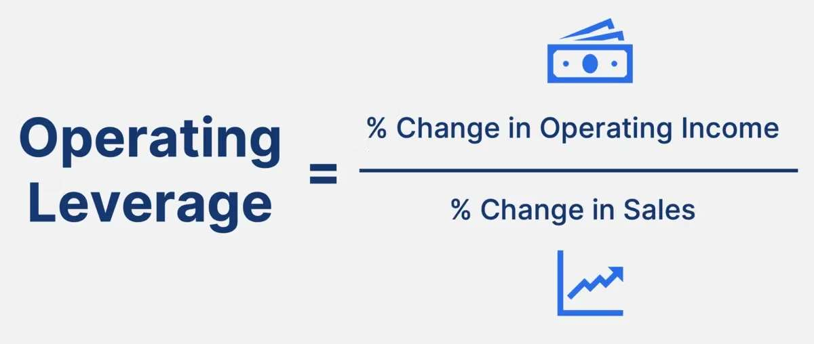

As a physics student, when the word “leverage” first appeared to me, I was thinking of torch and forces, and thus the idea of using a lever to lift something heavy with minimal effort. However, as I grew up witnessing the functioning of businesses and having economics classes, I came to realize that leverage isn’t just about tools and fulcrums. It’s a principle we use all the time, often without realizing it, in both our daily lives and in business. Leverage helps us achieve more with less by amplifying our efforts or resources.

*Source: [adammclane.com](https://adammclane.com/2012/01/fulcrum/)*

From saving time to growing a business, leverage is a powerful tool that increases efficiency, and amplifies impact, but also --- involves more risks.

## Leverage in Everyday Life

### 1. Technology as a Lever

Technology is one of the most obvious ways we leverage in daily life. From using navigation apps like Google Maps to avoid traffic, to fitness trackers that keep us accountable, technology amplifies our ability to achieve goals.

*Source: [constellationr.com](https://www.constellationr.com/blog-news/how-generative-ai-has-supercharged-future-work)*

For example, the invention of generative AI is a lever that we deploy to help us achieve more. With the aid of AI, we do not need to search on different websites for academic papers; just ask chat and it will collect all possible resources for you. Also, you do not need to wait until office hours to get your questions answered. For example, by feeding a math problem that you could not solve into the AI model you can get the answer quickly.

### 2. Small Changes with Big Results

Sometimes, the smallest adjustments can have the greatest impact. For instance, swapping sugary drinks for water can improve your health over time. Similarly, setting aside just $10 a week for savings may seem small, but with the power of compound interest, it grows into something significant.

These are examples of leverages in daily life --- small inputs creating big outcomes.

## Leverage in Commerce: Simple Examples

### 1. Financial Leverage: Borrowing to Grow

Imagine you want to open a coffee shop but don’t have enough money. By taking out a loan, you can set up your business and start earning money from sales. This is financial leverage—using borrowed money to grow your potential income.

*Source: [corporatefinanceinstitute.com](https://corporatefinanceinstitute.com/resources/commercial-lending/financial-leverage/)*

If your coffee shop does well, the profits will be much higher than the cost of the loan. But there’s a risk: if the business doesn’t succeed, you’ll still have to pay back the loan. That’s why it’s important to use financial leverage carefully, predict your profits, and optimize operations.

### 2. Operational Leverage: Fixed and Variable costs

Operational leverage refers to the use of fixed costs to achieve higher profitability. Companies with significant fixed costs, such as manufacturing firms, benefit disproportionately from revenue increases, as additional sales largely translate to profits once fixed costs are covered. This dynamic makes operational leverage a key consideration in industries with high upfront investments. For example, rent payments are fixed because no matter how much revenue is generated, business owners cannot stop paying the rent as long as the business is still in operation. As a result, the cyclicality of the generation of revenue should be considered when business owners manage operational leverage. The more invariant revenue is generated, the higher fixed costs can be allowed; on the opposite, the more fluctuating revenue is generated, you would want more variable costs.

*Source: [careerprinciples.com](https://www.careerprinciples.com/resources/operating-leverage-definition-formula-and-examples)*

For example, a retail store specializing in making ice-creams should have less fixed costs because during winter demand is relatively low. On the other hand, a clinic has a higher fixed costs percentage because patients do not “choose” the season to come.

### 3. People Power: Leveraging Teamwork

Businesses also use human leverage by hiring skilled workers to handle specialized tasks. For example, a startup might hire a graphic designer to create a logo or a marketer to promote their products. By working together, a team can accomplish far more than one person alone. This principle is why businesses prioritize building strong, collaborative teams.

Whether managing a personal life or running a business, the idea of leverage is the same: amplifying the effort or resources to get better results. It offers us an unprecedented manner of mindset when dealing with significant challenges.
