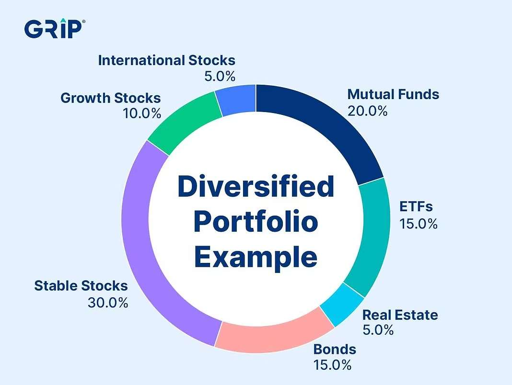
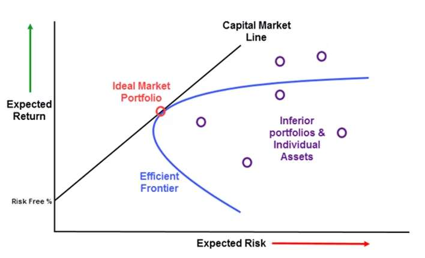
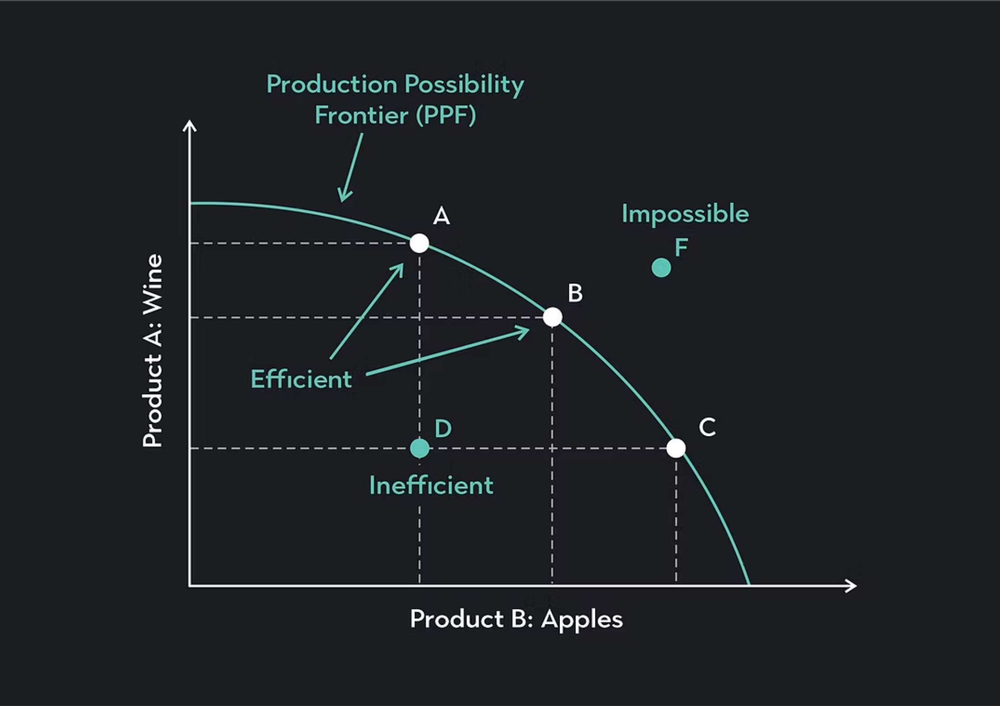
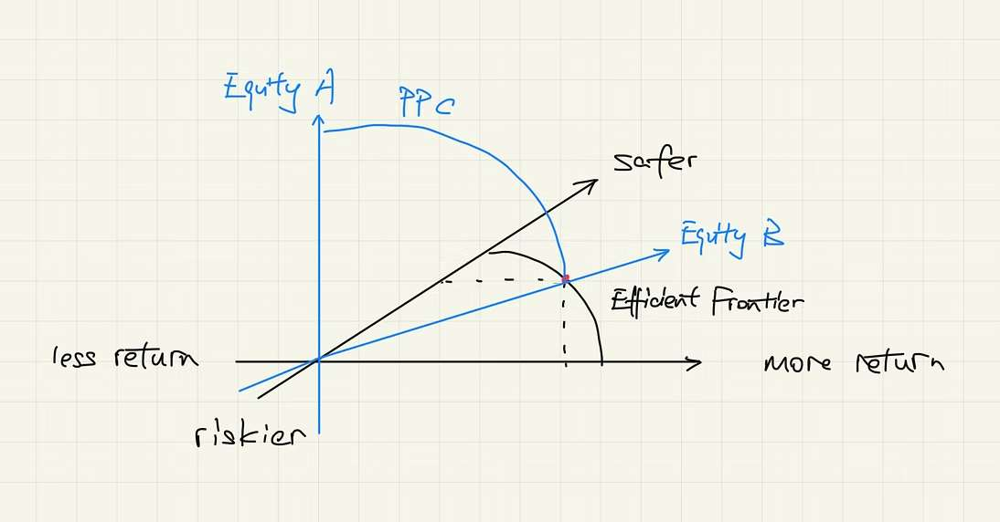
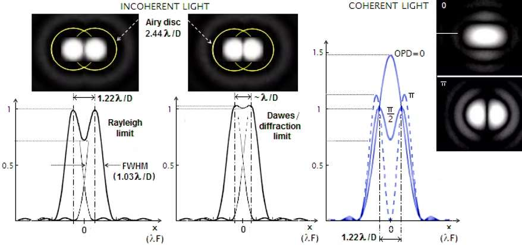

Portfolio diversification is one of the most important lessons taught in the finance industry. When investors select their “sexy” candidates and make the deal, they should always consider the limitations of their reasoning. Since equities might not perform as expected, it is always wiser to diversify the investment portfolio so that they do not cumulate into one or several related industries.

*Source: [gripinvest.in](https://www.gripinvest.in/blog/role-of-diversification)*

One concept in portfolio diversification is called the Efficient Frontier, a concept from Modern Portfolio Theory, which represents the set of optimal investment portfolios that maximize expected return for a given level of risk or minimize risk for a given level of return. It is essentially a graphical way of showing how to balance the trade-off between risk and reward. Portfolios lying on the Efficient Frontier are fully optimized, while those below it are considered suboptimal, as they either take on too much risk for a given return or offer too little return for the risk involved. Portfolios lying outside the frontier are unattainable.

*Source: [linkedin.com](https://www.linkedin.com/pulse/efficient-frontier-curve-sultan-saif-al-maiyahi/)*

As the Efficient Frontier demonstrates a negative relationship between safety and gains, it is similar to a concept in economics, the Production Possibilities Curve (PPC), which shows the trade-offs between producing two goods or services with limited resources. Both the Efficient Frontier and the PPC focus on optimizing outcomes under constraints. Points along the curve represent an efficient use of resources, while points inside the curve indicate inefficiency. The key difference lies in the context: the Efficient Frontier measures risk and return in financial portfolios, whereas the PPC deals with tangible quantities like goods or services.

*Source: [articles.outlier.org](https://articles.outlier.org/ppc-curve)*

However, there is another significant difference between Efficient Frontier and PPC. An Efficient Frontier is a fixed point of maximum return given risk or minimum risk given return, while PPC is a curve of possible combinations of products given efficiency and technology. The two concepts exist in perpendicular dimensions. The Efficient Frontier is a curve showcasing the trade-off of risk and return. When risk or return is given, another variable is fixed, and one can determine the optimal point on the curve. Then, perpendicular to the plane that the curve belongs to, we draw the Production Possibilities Curve that intersects with the optimal point, which symbolizes various combinations of possible equities that we can invest in.

*self-made illustration*

We can use the two-step method in various situations in our daily life and other fields of study. In health and fitness, the Efficient Frontier could guide you to find the best balance between diet and exercise that maximizes energy levels while minimizing effort or stress. The PPC might help you decide how to divide your efforts between physical fitness and mental well-being, ensuring neither is neglected. When building a telescope, one has to decide between observational precision and practicality. Since the diameter of the scope is nearly reversely proportional to the resolution angle, scientists can only attain a maximum resolution quality given the diameter or attain the smallest diameter given the resolution quality. After selecting the optimal point on the Efficiency Frontier, scientists would consider distributing limited funds into multiple aspects of a telescope such as sensitivity, automatic tracing, and signal-to-noise ratio.

*Source: [telescope-optics.net](https://www.telescope-optics.net/telescope_resolution.htm)*

Both the Efficient Frontier and the PPC highlight an important lesson: life is full of trade-offs. Whether it is balancing risk and return, production priorities, or how you spend your time and energy, aiming for the "frontier" ensures you’re making the most of your resources.
