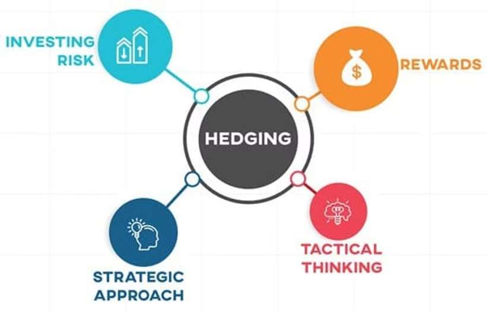
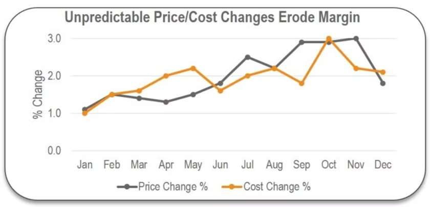
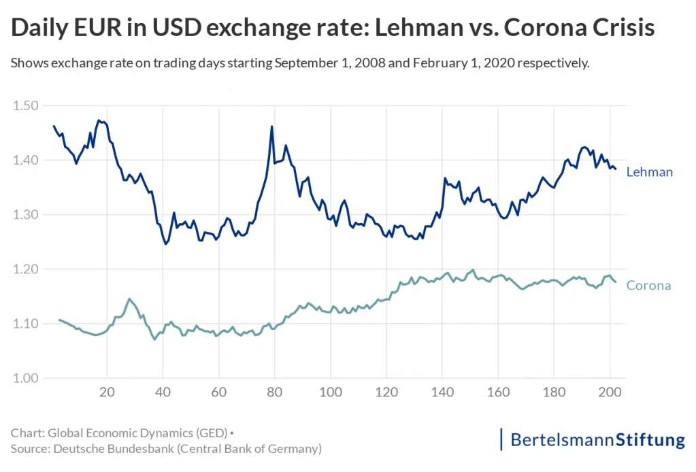
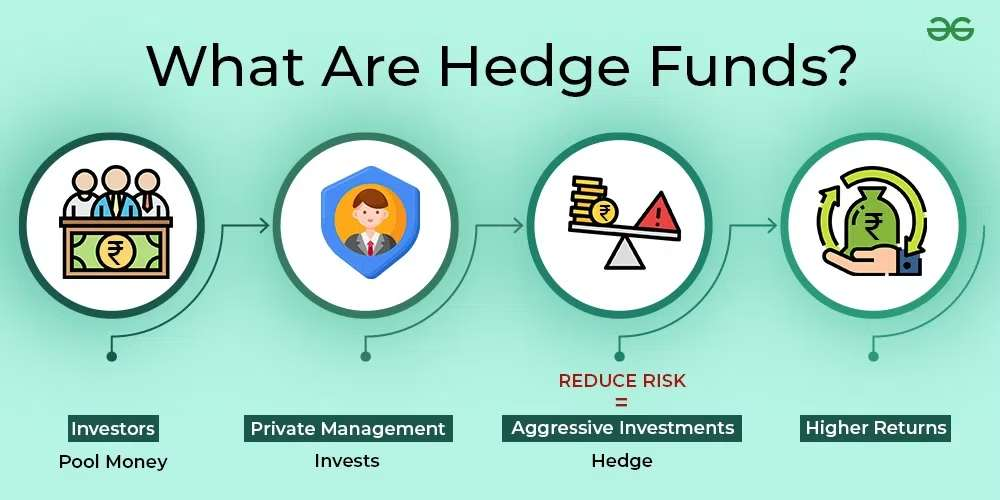

When studying the various finance institutions, you probably have heard of hedge funds as a major participant in the buy-side economy. Hedge funds get their names from the concept of hedging, which acts like buying insurance for your financial decisions. Just as you might insure your car against accidents or your house against natural disasters, hedging is a way to protect your investments or business operations from unpredictable events that could cause financial harm. It is a strategy used to reduce the risk of losing money due to price fluctuations in markets—whether that is the stock market, currency exchange rates, or the cost of raw materials. While it does not eliminate risk entirely, hedging provides a safety net, ensuring that even if things don’t go as planned, the impact won’t be devastating. However, since risk and return are always correlated, the saving of risks also reduces the possible return you might get. This is a trade-off and you have to select between high and low risks and returns.

*Source: [peakframeworks.com](https://www.peakframeworks.com/post/hedging-financial-strategy)*

Imagine you are a farmer growing wheat. You know the price of wheat can change dramatically depending on factors like weather, demand, or global markets. If prices fall at harvest time, you might not make enough to cover your costs. To avoid this uncertainty, you could sell your wheat in advance through a futures contract at a fixed price. This way, even if prices drop, you are protected. On the flip side, if prices go up, you will not benefit from the higher prices because you have already locked in your rate. Hedging helps you sleep better at night, knowing you have minimized your risk, even if it means giving up some potential extra profit.

*Source: [insight2profit.com](https://www.insight2profit.com/how-to-effectively-manage-unpredictable-cost-changes/)*

Hedging is not just for farmers or big corporations—it happens in everyday life, often without us realizing it. For instance, if you are planning a vacation abroad and are worried about currency fluctuations making your trip more expensive, you might exchange your money early or use a tool to lock in today’s exchange rate. That is hedging. Or think about health insurance. You pay a premium every month so that if something unexpected happens, like a medical emergency, you do not have to bear the full financial burden. These are practical examples of how hedging helps manage uncertainty in our daily lives.

*Source: [globaleurope.eu](https://globaleurope.eu/globalization/why-exchange-rate-fluctuations-matter-especially-now/)*

In financial markets, hedging often involves sophisticated tools like options, futures, or swaps. For example, an investor worried about a potential stock market drop might buy a "put option," which gives them the right to sell their stocks at a predetermined price, no matter how much the market falls. While they pay a fee (the option premium) for this protection, it can save them from significant losses. Similarly, a business that imports goods might use a hedging strategy to protect against changes in currency exchange rates. By locking in an exchange rate today, they avoid the risk of paying more if the currency weakens.

*Source: [geeksforgeeks.org](https://www.geeksforgeeks.org/what-are-hedge-funds-features-benefits-and-working/)*

At its heart, hedging is about balancing risk and reward. It’s not a strategy for making huge profits but rather for preserving stability and predictability in the face of uncertainty. Just as wearing a seatbelt does not make you a better driver but keeps you safer in case of an accident, hedging does not guarantee financial success but protects you when things don’t go as planned. Whether you’re an investor, a business owner, or just someone planning a big purchase, understanding and applying the principles of hedging can help you manage risks and make more confident decisions.
