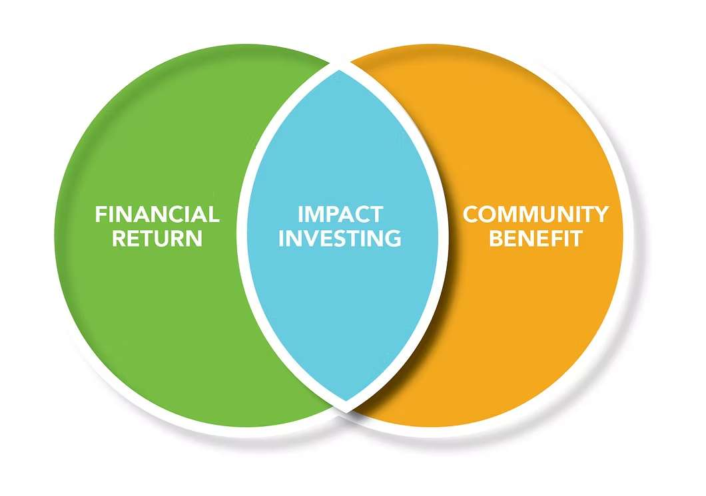
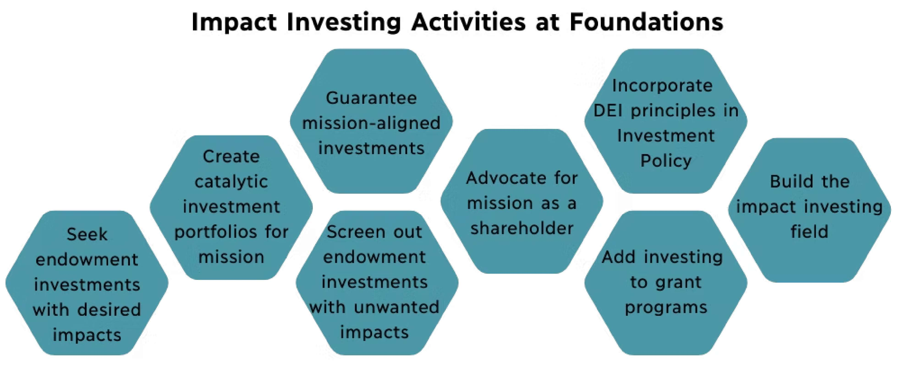
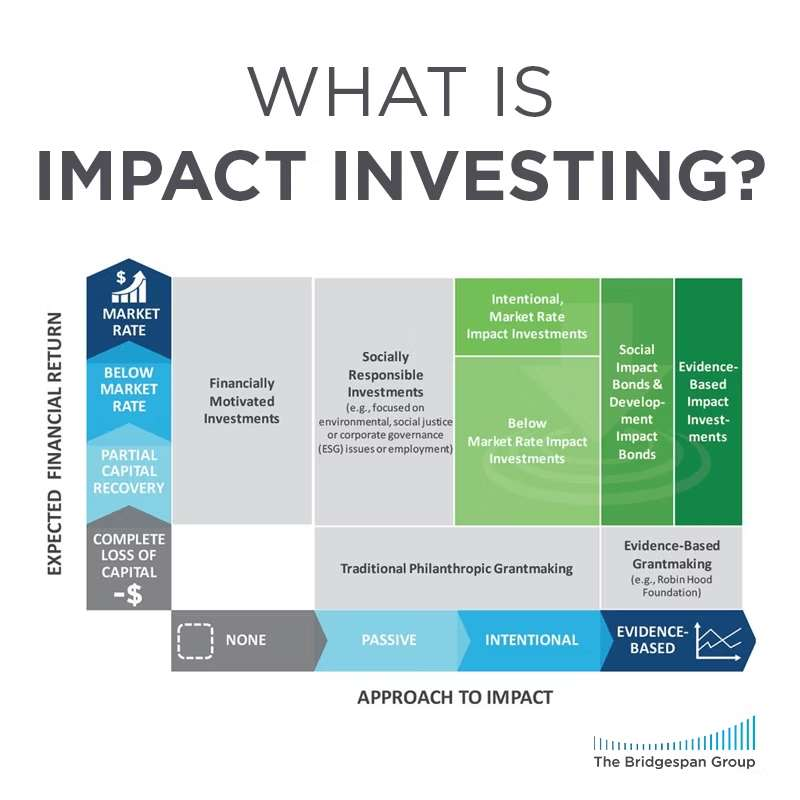

In recent years, the concept of impact investing has gained significant attention globally in the fields of politics, environmental sciences, and finance. In its essence, impact investing represents a strategy of investment that not only seeks financial returns but also generates social and environmental benefits. This dual objective differs from the traditional notion that the sole goal of commerce is to generate as much profit for its shareholders, and that profit and purpose must operate in separate spheres. Although many may think of impact investing as a demonstration of philanthropy and masking, I do have some perspectives on its significance.

*Source: [greatermilwaukeefoundation.org](https://www.greatermilwaukeefoundation.org/tools-for-change/impact-investing/)*

Impact investing is not just creating public good as we generate profits, it redefines the role of capital in addressing global challenges. With pressing issues such as climate change, income inequality, and the disparity of access to education and healthcare, traditional philanthropy and government interventions alone cannot bridge the gap. This is because they lack incentives for the supplier to scale events and create significant and lasting effects. Since businesses create incentives for people to change their behavior, commercialization is the only way out. By mobilizing private capital to tackle these challenges, impact investing offers a scalable solution. It provides a framework where investors can directly channel their resources into companies, organizations, and funds that strive to make a positive impact on society while maintaining profitability.

*Source: [philanthropynw.org](https://philanthropynw.org/impact-investing)*

Impact investing is also a catalyst for innovation. By funding entrepreneurs and businesses that focus on sustainability through their products and technological advancements, it fosters the development of groundbreaking solutions. For instance, renewable energy startups, affordable housing projects, and fintech platforms aimed at giving equal access to financial resources have all flourished due to impact-focused capital. These investments not only address societal challenges but also drive economic growth and increase employment, results that extend far beyond the scope of being virtuous.

*Source: [bridgespan.org](https://www.bridgespan.org/insights/what-is-impact-investing)*

Impact investing is more than a trend; it is a paradigm shift in the way we think about the role of capital. By aligning financial goals with social and environmental priorities, it empowers investors to be drivers of change. As this approach continues to gain momentum, it holds the potential to redefine investment strategies and drive transformative outcomes for individuals, communities, and the planet. The significance of impact investing lies not just in its promise but in its proven ability to make a difference—for both profits, people, and the planet.
